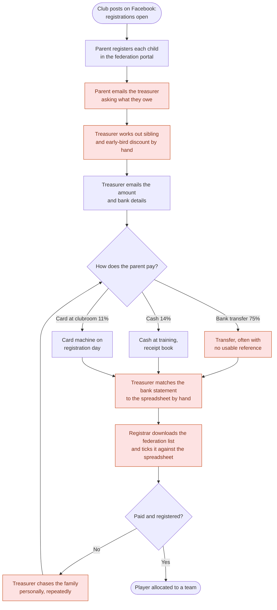
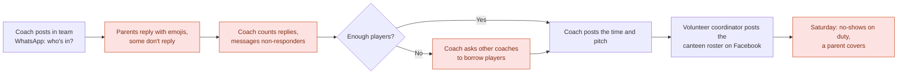

# Current-State Analysis

GitHub renders the Mermaid diagrams on this page directly.

## 1. As-is: registration and fee collection (December – April)

## 2. As-is: a match week (April – August)

## 3. Pain points
| # | Pain point | Who feels it | Evidence | Impact |
|---|-----------|--------------|----------|--------|
| P1 | Fees are collected outside registration, so families can register without paying | Treasurer, families | 20% of 2026 fees still unpaid at round 1 | A$2.3K outstanding; 12 families chased; A$2.3K never collected over 3 seasons |
| P2 | Sibling discount worked out by hand | Treasurer, parents with 2+ children | 2+ child families took 39 days on average to pay (26 for one-child families); 11% never paid (3% for one-child families) | Slowest-paying group; most chasing |
| P3 | Bank transfers without references | Treasurer | 13 of 49 transfers (27%) needed manual matching | About 6 hours a season of reconciliation |
| P4 | Late registrations | Coach coordinator | 10 players (15%) registered after the grading deadline | Teams rebalanced after they had been announced |
| P5 | Availability chased in group chats | Coaches, parents | Time diary: ~1 hour per coach per week | ~120 coach hours a season |
| P6 | WWCC tracked in a spreadsheet | Child safety officer | 2 of 12 coaches and team managers had an expired or unchecked WWCC at round 1 in 2026 (found in the audit during discovery) | Child-safety compliance risk |
| P7 | Duty roster on Facebook | Volunteer coordinator | 1 in 5 duties had a no-show (coordinator's estimate) | The same few parents always cover |
| P8 | Website can't be updated | Secretary | Last update 2024; fixtures are not shown | New families can't find how to join |

## 4. Volunteer-hours baseline (from the time diary, per season)
| Activity | Who | Hours |
|----------|-----|------:|
| Registration admin, federation cross-checks | Registrar | 40 |
| Fee calculation, chasing and reconciliation | Treasurer | 25 |
| Availability, team messages, attendance | 6 coaches | 120 |
| Duty roster | Volunteer coordinator | 15 |
| Website and social updates | Secretary | 20 |
| **Total** | | **≈ 220** |

## 5. Root cause: why do 20% of fees arrive late?
**Five whys**
1. **Why are fees unpaid at round 1?** Families don't pay when they register.
2. **Why not?** They don't know the amount yet, and nothing links paying to registering.
3. **Why don't they know the amount?** The sibling and early-bird discounts are worked out by hand after registration.
4. **Why by hand?** The federation portal only handles federation fees, and the club never had a tool for its own fees.
5. **Why no tool?** No committee member had the time or skills to set one up. Every volunteer works around the problem in their own role.

**Root cause:** club fees are disconnected from registration, and the discount rules exist only in the treasurer's head.
**Countermeasure:** take payment during registration, with the discount rules configured in the system (FR-04 to FR-08).

## 6. Survey highlights (38 of 51 families)
| Finding | % |
|---------|--:|
| Would rather pay by card or Apple/Google Pay than bank transfer | 84% |
| Have missed a time or venue change because of chat noise | 61% |
| Would use a club app if it replaced the WhatsApp groups | 89% |
| Would sign up for volunteer duties if they could pick a slot and swap | 74% |
| Want a reminder the night before and the morning of a game | 92% |
