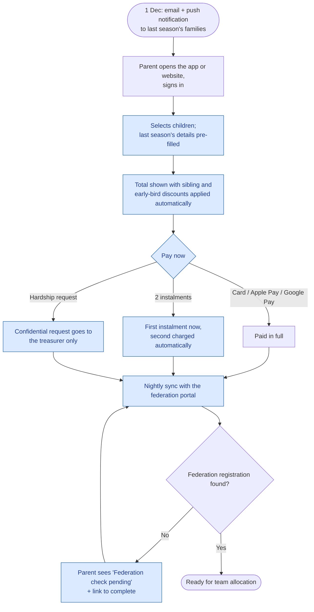
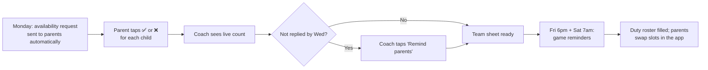
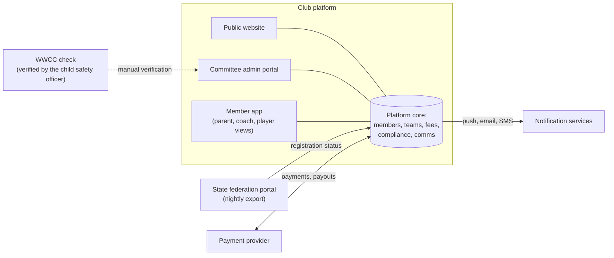

# Future State & Solution Overview

## 1. To-be: registration and payment

## 2. To-be: match week

## 3. Solution context

## 4. Information architecture
### Public website
- Home: next fixtures, latest news, "Join the club"
- About: committee, history, child-safe policy
- Teams & fixtures
- Join: age groups, fees, how to register
- Sponsors
- Contact

### Member app
| Parent view | Coach / team manager view | Player view (parent-controlled) |
|-------------|---------------------------|---------------------------------|
| Family home: each child's next game | My team: next game + availability count | My team: next game, training times |
| Register & pay | Team sheet | Team list (first names only) |
| Availability per child | Attendance | My medals |
| Announcements | Send announcement (to parents) | — |
| My volunteer duties | My WWCC status | — |
| Payment history | — | — |

### Committee admin portal
Dashboard · Registrations · Fees & payouts · Teams · Compliance (WWCC) · Volunteer roster · Announcements · Website content · Reports · Settings (fee rules, age groups, duty types)

## 5. Roles and permissions
| Capability | Parent | Player | Coach / TM | Registrar | Treasurer | Child Safety Officer | President |
|------------|:-:|:-:|:-:|:-:|:-:|:-:|:-:|
| Register and pay for own children | ✅ | — | ✅* | — | — | — | — |
| See own children's fixtures | ✅ | ✅ (own) | ✅ | ✅ | ✅ | ✅ | ✅ |
| See team list | First names | First names | Full + guardian contacts | ✅ | ✅ | ✅ | ✅ |
| Send team announcement | — | — | ✅ to parents | ✅ | — | ✅ | ✅ |
| Message a player directly | — | — | **Never** | **Never** | **Never** | **Never** | **Never** |
| See fees and hardship requests | Own | — | — | Status only | ✅ | — | Totals only |
| Verify WWCC / block staff | — | — | — | — | — | ✅ | — |
| Edit website | — | — | — | ✅ | — | — | ✅ |

\* Coaches who are also parents use the parent view for their own children.

## 6. Gap analysis
| Capability | As-is | To-be | Requirement |
|------------|-------|-------|-------------|
| Fee collection | Separate from registration; bank transfer | Paid during registration; card or wallet; instalments | BR-01, FR-04–FR-08 |
| Discounts | Worked out by the treasurer | Configurable rules applied automatically | FR-05 |
| Federation status | Manual cross-check | Nightly sync with exceptions list | BR-02, FR-03 |
| Team allocation | Spreadsheet, redone for late registrations | Drag-and-drop allocation; registration closes at the grading deadline with a waitlist | BR-03, FR-09–FR-10 |
| WWCC | Spreadsheet | Register with expiry alerts; hard block on assigning unverified staff | BR-04, FR-11–FR-13 |
| Team comms | WhatsApp groups | Announcements to parents only; no direct messages to children | BR-05, FR-14–FR-17, BRL-05–08 |
| Availability | Emojis in chat | Automatic request, live count, reminders | BR-05, FR-18–FR-19 |
| Volunteer roster | Facebook post | Pick a slot, swap, reminders | BR-06, FR-20–FR-21 |
| Website | Old and can't be edited | Committee can edit pages; fixtures shown automatically | BR-07, FR-22–FR-24 |
