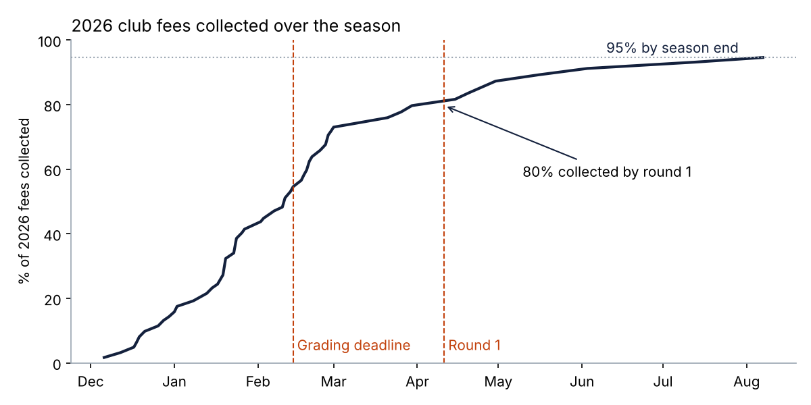
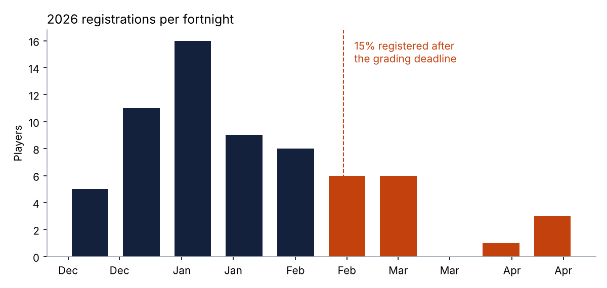
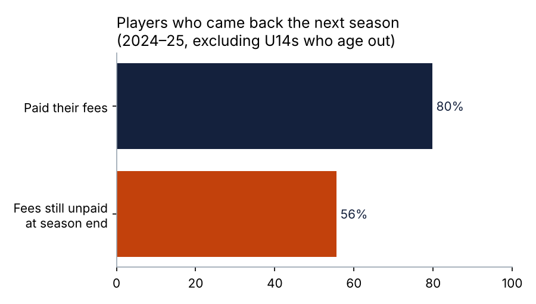

# Data Analysis: Findings
**Data:** registration and payment records for 2024–2026 (190 player-seasons: 61, 64 and 65 players), synthetic but based on the patterns found in discovery.
**Tools:** Python (pandas, matplotlib) and SQL (SQLite). To reproduce, see [`scripts/`](scripts/) and [`sql/registration_analysis.sql`](sql/registration_analysis.sql).

> **About the sample size:** this is a 65-member club, so a difference of one or two families moves the percentages noticeably. I used the data to show the size and direction of each problem, and checked each finding against the interviews and the survey before relying on it.

## 1. A fifth of fees still unpaid at round 1

| Season | Players | Fees due | Paid by round 1 | Never collected |
|--------|--------:|---------:|----------------:|----------------:|
| 2024 | 61 | A$10,514 | 72.2% | A$844 |
| 2025 | 64 | A$10,654 | 69.7% | A$868 |
| 2026 | 65 | A$11,208 | 79.7% | A$608 |

At round 1 in 2026, **A$2,278 was still owed by 12 families**. Over three seasons, **A$2,320 was never collected**. For a club with an annual fee income of about A$11K, that is significant. The treasurer also has to chase families he knows socially, which wears him down.

## 2. Families with more than one child pay last
| Family | Players | Avg days to pay | Paid by round 1 | Never paid |
|--------|--------:|----------------:|----------------:|-----------:|
| 1 child | 38 | 25.5 | 86.8% | 2.6% |
| 2+ children | 27 | **39.0** | **74.1%** | **11.1%** |

The interviews explained why. Families with siblings wait for the treasurer to email them the discounted amount, and some never receive it. → *Apply discounts automatically at registration (FR-05).*

## 3. Bank transfers create reconciliation work
| Method (2026) | Players | Share | Missing reference | Avg days to pay |
|---------------|--------:|------:|------------------:|----------------:|
| Bank transfer | 49 | 75% | **13 (27%)** | 32 |
| Cash | 9 | 14% | — | 23 |
| Card at clubroom | 7 | 11% | — | 32 |

→ *Card and wallet payments matched automatically to each child (FR-06).*

## 4. Late registrations disrupt team allocation

In 2026, **10 players (15%) registered after the 14 February grading deadline**, compared with 28% in 2024. The improvement came from the registrar's personal reminders, which took her time. → *Registration closes at the deadline, with a waitlist after it (FR-09), and automatic reminders.*

## 5. Unpaid fees and players leaving go together

Of players whose fees were paid, **80%** came back the next season. Of players whose fees were still unpaid at season end, **56%** came back. U14s are excluded because they age out of the club.

The unpaid group is small (9 players), so this is a signal rather than proof. It matches what the treasurer described: families who fall behind feel awkward and quietly move on. → *A confidential hardship option (FR-08) and instalments (FR-07).*

## 6. What this means for priorities
| Finding | Requirement | Release |
|---------|-------------|:-:|
| Fees collected late or never | Pay at registration, card and wallets, instalments | R1 |
| Sibling families slowest | Automatic, configurable discounts | R1 |
| 27% of transfers need manual matching | Online payments only | R1 |
| 15% register after the deadline | Waitlist after the deadline, automatic reminders | R1 |
| Unpaid families don't return | Confidential hardship option | R1 |

The data showed that payment and registration problems cost the club the most money and volunteer time. This supported putting registration and payments in **Release 1**, ahead of the match-day app features the coaches asked for first.
