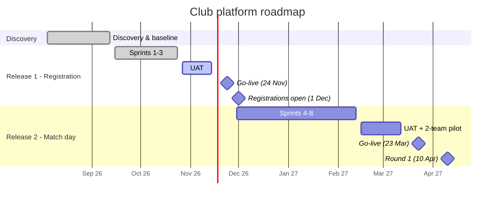

# Delivery Approach & My Role as BA

## 1. Roadmap

## 2. Sprint rhythm (2-week sprints)
| When | Ceremony | My role as BA |
|------|----------|---------------|
| Day 1 | Sprint planning | Walk the team through ready stories; answer questions on scope |
| Daily | Stand-up | Unblock questions on requirements the same day; take questions back to the club |
| Week 1, Thu evening | Club PO catch-up | Confirm business rules and edge cases; get decisions |
| Week 2 | Backlog refinement | Bring the next sprint's stories to Definition of Ready with the developers, QA and UX |
| Day 10 | Sprint review at the clubroom | Demo to the committee and coaches; capture feedback as new or changed stories |
| Day 10 | Retro | Improve how requirements flow to the team |

## 3. Definition of Done (team-agreed)
- Acceptance criteria met and verified by QA
- Code peer-reviewed, automated tests pass
- Accessibility checked (WCAG 2.2 AA)
- Child-safety rules checked where relevant (BRL-05 to BRL-08)
- Demoed to the club PO and accepted

## 4. Change control
Every change request goes through the same steps:
1. The BA logs the request.
2. The BA writes an impact analysis covering scope, cost, timeline, risk and whether it affects the platform for other clubs.
3. The Delivery Manager and the Platform PM review it.
4. The club PO decides.

| CR | Request | Impact | Decision |
|----|---------|--------|----------|
| CR-01 | Live federation lookup instead of a nightly sync | Not possible: the federation offers only a nightly export | Withdrawn; FR-03 updated to show "federation check pending" |
| CR-02 | Sibling discount of 15% for the third child | Small; built as a configurable rule (NFR-08) | Approved at no cost |
| CR-03 | Group chat for U12–U14 players | Conflicts with the child-safe policy (BRL-05) | Declined by the child safety officer |
| CR-04 | Team photo gallery | Needs a child-safety and consent review | Moved to the R3 backlog |

## 5. Risks and issues (current)
| ID | Risk / issue | Rating | Mitigation | Owner |
|----|--------------|:-:|------------|-------|
| R-01 | Release 1 slips past 1 Dec | Medium | R1 scope locked; DEF-012 fix in progress (see UAT plan) | Delivery Manager |
| R-02 | Parents keep using WhatsApp | High | Coaches close the old groups at R2 launch, backed by the committee | Club President |
| R-03 | Low app adoption among grandparents and carers | Medium | Everything works on the website too; help at the registration day | BA + Secretary |
| R-04 | App store rejection delays R2 | Low | Submit by 2 Mar, 3 weeks of buffer | Mobile lead |
