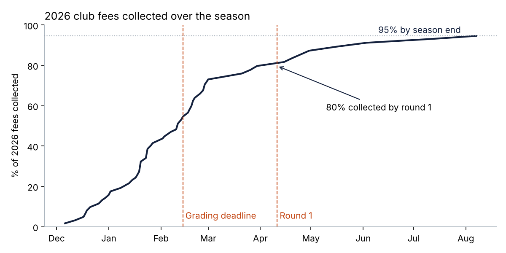

# ⚽ Club Platform for a Local Junior Soccer Club: an Agency-Side Business Analysis Case Study

> **Community sport · Website + admin portal + mobile app · Business Analyst portfolio project**
> How I gathered requirements from a volunteer committee and worked with my company's product, design and engineering teams to deliver a website, an admin portal and a member app for a 65-member junior club. The app has separate views for parents, coaches and players.

*The club, the people and all data are fictional. They were created for portfolio use and are not taken from any employer or client.*

---

## 📌 The situation
A local soccer club for children under 14 (65 players, 6 teams, all volunteers) ran on a spreadsheet, bank transfers and WhatsApp groups. In 2026:
- **20% of fees were still unpaid at round 1.** The treasurer had to chase 12 families personally.
- **15% of players registered after the team grading deadline.**
- **27% of bank transfers** needed manual matching.
- Volunteers spent **~220 hours a season** on admin.
- Working With Children Checks were tracked in a spreadsheet nobody checked.

My company, a digital agency building a platform for community clubs, took the club on as its first pilot client. I was the BA between the two.

## 🧩 What we're delivering
| Product | For | Release |
|---------|-----|---------|
| Public website | New families, sponsors, community | R1 · 24 Nov 2026 |
| Committee admin portal | Registrar, treasurer, child safety officer, coach coordinator | R1 · 24 Nov 2026 |
| Member app: **parent view** | Register and pay, availability per child, announcements, volunteer duties | R1 (registration) + R2 |
| Member app: **coach & team manager view** | Availability count, announcements to parents, attendance | R2 · 23 Mar 2027 |
| Member app: **player view** | Parent-controlled and view-only: next game, team, medals; no messaging | R2 · 23 Mar 2027 |

## 🎯 Targets for the 2027 season
| | 2026 | 2027 target |
|---|---:|---:|
| Fees paid by round 1 | 79.7% | **≥ 95%** |
| Registered before grading deadline | 84.6% | **≥ 95%** |
| Volunteer admin hours | ~220 | **≤ 80** |
| Coaches and team managers with a verified WWCC | not tracked | **100%, enforced** |



---

## 🗺️ Repo map (follows the BA lifecycle)
| Phase | Deliverable | What it shows |
|-------|-------------|---------------|
| **1. Discovery** | [Project charter](01-discovery/project-charter.md) | Objectives, scope by product, an options analysis that includes an honest caveat, funding for both the club and the agency, timeline |
| | [Stakeholder analysis](01-discovery/stakeholder-analysis.md) | Client, agency and external stakeholders; RACI; communication plan; **3 conflicts I resolved** |
| | [Personas & journeys](01-discovery/personas-and-journeys.md) | Parent, coach, registrar, treasurer, child safety officer, player; journey maps |
| **2. Analysis** | [Current state](02-analysis/current-state-analysis.md) | As-is process maps, pain points, volunteer-hours baseline, 5 Whys, survey |
| | [Future state & solution](02-analysis/future-state-and-solution.md) | To-be processes, solution context, information architecture, **roles and permissions matrix**, gap analysis |
| **3. Requirements** | [BRD](03-requirements/business-requirements-document.md) | Business and functional requirements by module, NFRs, **child-safety business rules**, release plan |
| | [User stories](03-requirements/user-stories.md) | 19 stories with Gherkin acceptance criteria and Definition of Ready |
| | [Product backlog](03-requirements/product-backlog.csv) · [Traceability matrix](03-requirements/requirements-traceability-matrix.csv) | Sprint and release plan; requirement → story → test |
| **4. Data** | [Findings](04-data-analysis/findings.md) · [SQL](04-data-analysis/sql/registration_analysis.sql) · [Python](04-data-analysis/scripts/) | 3 seasons of registration and payment data, with a note on small sample sizes |
| **5. Delivery** | [Delivery approach](05-delivery/delivery-approach.md) | Roadmap, the BA's role in each sprint ceremony, change requests, risks |
| | [UAT plan](05-delivery/uat-plan.md) · [Test cases](05-delivery/uat-test-cases.csv) | Volunteer testers, entry and exit criteria, live defect status |
| | [Change & benefits](05-delivery/change-and-benefits.md) | Change impact, launch comms, hypercare, KPIs and guardrails, lessons learned |

---

## 🔑 Decisions I'm proud of
1. **Child safety over convenience.** Coaches wanted chat with older players. With the child safety officer I agreed rules that are now built into the product: no messages to children, announcements to parents only, first names only. Dropping chat also removed the team's biggest technical risk.
2. **Configurable, not custom.** The club wanted its own discount rules, and the agency didn't want this club's rules hard-coded. I turned requests into settings any club can configure, so the club got what it needed and the agency's platform got features it can offer other clubs.
3. **Letting the data set the order.** Coaches asked for match-day features first. The data showed that registration and payments cost the club the most money and volunteer time, so they went into Release 1, before 2027 registrations open.
4. **Being honest about options.** For a 65-member club, an off-the-shelf app is a reasonable choice. I said so in the options analysis, so the committee chose the pilot with full information.

## 🧰 Skills demonstrated
Requirements gathering with non-technical volunteers · working with an agency delivery team (PM, architect, UX, developers, QA) · personas and journey mapping · process modelling · roles and permissions design · BRD, NFRs and business rules · user stories with Gherkin · MoSCoW and release planning · traceability · SQL and Python analysis · change control · UAT with volunteer testers · change management · benefits tracking · child-safe and privacy requirements

## ▶️ Reproduce the analysis
```bash
pip install -r requirements.txt
cd 04-data-analysis/scripts
python generate_data.py   # 3 seasons of synthetic registrations + SQLite DB
python analyse.py         # runs the SQL, prints results, saves charts
```

---
*Author: Maaz Sharieff · Business Analyst · [LinkedIn](https://linkedin.com/in/your-profile)*
